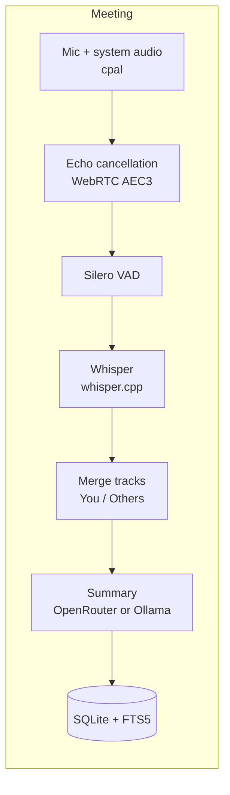
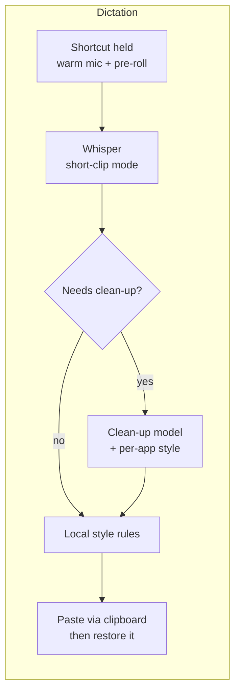

<div align="center">


# Quill

**Local-first meeting notes and dictation for macOS and Windows.**

Record any call and get a transcript plus structured notes. Or hold a key, speak, and have clean text typed into whatever app you're using. Audio is processed on your computer and never uploaded.

[](https://github.com/fisherinnovation/quill/actions/workflows/ci.yml)
[](#license)

</div>

> [!NOTE]
> Quill is in early development (v0.1). There are no prebuilt releases yet:
> you build it from source. It's in daily use on macOS; the Windows build
> compiles and passes tests in CI but hasn't had real-world testing. Expect
> rough edges, and please [report them](https://github.com/fisherinnovation/quill/issues).

## Contents

- [Features](#features)
- [Privacy](#privacy)
- [Platform support](#platform-support)
- [Building from source](#building-from-source)
- [Using Quill](#using-quill)
- [Summary and clean-up models](#summary-and-clean-up-models)
- [Command-line tool](#command-line-tool)
- [Where your data lives](#where-your-data-lives)
- [How it works](#how-it-works)
- [Performance](#performance)
- [Development](#development)
- [Roadmap](#roadmap)
- [Known limitations](#known-limitations)
- [Contributing](#contributing) · [Security](#security) · [License](#license) · [Acknowledgments](#acknowledgments)

## Features

### Meeting notes

- **Works with any call app.** Zoom, Google Meet, Teams, a browser tab, a phone app mirrored to your computer. Nothing joins the call as a bot.
- **Two tracks, real speaker labels.** Your microphone is recorded as **You**, the system audio as **Others**, so the transcript knows who said what without a diarization model.
- **Echo cancellation.** If you use speakers instead of headphones, a WebRTC echo canceller removes the call's audio from your microphone track before transcription.
- **Local transcription** with [Whisper](https://github.com/openai/whisper) through [whisper.cpp](https://github.com/ggerganov/whisper.cpp), GPU-accelerated on Apple Silicon. Silence is skipped first, so Whisper doesn't invent text in quiet stretches.
- **Structured notes** written by a model you choose: TL;DR, decisions, action items with owners, discussion by topic and open questions. Long meetings are summarized in parts and combined.
- **A searchable library.** Full-text search across every transcript, click-to-rename titles, export to Markdown, all stored in a local SQLite database.
- **Compact storage.** Recordings are kept as 16 kHz FLAC once transcribed, about 70 MB per hour.

### Dictation

- **Hold a shortcut and speak** (<kbd>⌥ Option</kbd> + <kbd>Space</kbd> by default), and the text is typed wherever your cursor is. Or tap the shortcut to start and tap again to stop. <kbd>Esc</kbd> cancels.
- **Fast.** About 0.3 s from releasing the key to typed text on an M3 Pro, because Whisper stays loaded and runs in a mode tuned for short clips.
- **Clean-up only when it helps.** A model removes "um"s, applies self-corrections ("at 3, no wait, 4" becomes "at 4") and formats spoken lists. It only runs when there's something to fix, and its output is checked before use, so it can't type an answer to your question instead of your question.
- **Per-app style.** Casual in chat apps, formal in email, exact names and commands in code editors and terminals. Built-in defaults, and you can change any app.
- **Your words.** A vocabulary list for names and jargon, plus replacement rules ("open router" → "OpenRouter").
- **A floating indicator** with a live level meter, start and stop sounds, and a menu-bar status.
- **Your clipboard is preserved.** Text is inserted by pasting; whatever you had copied is put back, and the dictated text is hidden from clipboard managers.

### Insights

- Words dictated, time saved compared with typing, speaking speed, streaks, a 30-day activity chart, time of day and top apps.
- Meeting count and hours, and your share of the talking.
- Built from counts only: Quill keeps numbers about dictations, not what you said.

## Privacy

Quill is built so that the sensitive parts stay on your computer.

| Data | Where it goes |
|---|---|
| **Audio** (meetings and dictation) | Never leaves your computer. Transcription runs locally. |
| **Meeting transcripts** | Sent to the summary model you choose: [OpenRouter](https://openrouter.ai) (routed only to providers that don't store or train on your data; zero-data-retention mode available), or a local [Ollama](https://ollama.com) model, so nothing leaves your machine. Summaries are optional. |
| **Dictated text** | Sent to the clean-up model only when clean-up runs (fillers, corrections, lists). Clean-up can be turned off or pointed at a local Ollama model. |
| **API keys** | Stored in the macOS Keychain or Windows Credential Manager, never in config files or logs. |
| **Logs** | Local files with events, timings and errors. Never transcripts, notes, dictated text or keys. |
| **Telemetry** | None. Quill makes no network requests other than the model calls above and downloading the speech models. |

For dictation, Quill reads the *name* of the frontmost app (for per-app style and insights), never its windows or contents.

## Platform support

| | macOS | Windows |
|---|---|---|
| Minimum OS | macOS 14.6 (system-audio capture uses Core Audio process taps) | Windows 10 / 11 |
| Transcription | Metal GPU on Apple Silicon | CPU; CUDA or Vulkan available in the CLI with a build flag |
| Meeting notes | ✅ Used daily | 🧪 Builds and passes CI; not yet tested in real use |
| Dictation | ✅ Used daily | 🧪 Builds and passes CI; not yet tested in real use |
| Signed installers | Not yet (planned) | Not yet (planned) |

Apple Silicon is strongly recommended on macOS: Whisper runs several times faster on its GPU. Linux isn't supported.

## Building from source

### Prerequisites

- **Rust**, latest stable, via [rustup](https://rustup.rs).
- **Node.js 24** and npm, for the app's interface.
- **CMake and a C/C++ compiler**, to build whisper.cpp:
  - macOS: `xcode-select --install` (the Command Line Tools are enough; full Xcode isn't needed) and `brew install cmake`.
  - Windows: [Visual Studio 2022 Build Tools](https://visualstudio.microsoft.com/visual-cpp-build-tools/) with the *Desktop development with C++* workload, which includes CMake.

### Build and run

```sh
git clone https://github.com/fisherinnovation/quill.git
cd quill/app
npm ci

npm run app          # development: hot reload for the interface
npm run app:bundle   # macOS: build ~/Applications/Quill.app and open it
npx tauri build      # release bundle (.app/.dmg on macOS, .msi/.exe on Windows)
```

The first build compiles whisper.cpp and takes several minutes; later builds are incremental.

> [!TIP]
> **Developing on macOS:** macOS ties permissions (microphone, system audio,
> Accessibility) to an app's code signature. Development builds use a
> throwaway signature, so permissions reset on every rebuild. To keep them,
> create a code-signing certificate named **Quill Development** once:
> Keychain Access → Certificate Assistant → Create a Certificate…, with
> Identity Type *Self-Signed Root* and Certificate Type *Code Signing*.
> `npm run app:bundle` signs with it whenever it exists. Also use
> `app:bundle` (not `app`) to test dictation, because macOS only lets real
> app bundles into the Accessibility list. See [`app/README.md`](app/README.md).

### First run

1. A welcome screen explains what Quill records, then runs an **access check**: a few seconds of recording plus a short chime, which also brings up the permission prompts. Allow **Microphone** and **System Audio Recording**.
2. For dictation, open **Dictation** and click **Allow…** to grant **Accessibility**, which Quill needs to paste for you. Without it, dictated text is left on your clipboard.
3. The speech models download automatically the first time they're needed: `turbo` (1.5 GB) and the Silero VAD model (1 MB), from Hugging Face, each checked against its SHA-256 hash.
4. For summaries, add an OpenRouter key in **Settings**, or choose a local Ollama model (see below).

## Using Quill

### Recording a meeting

Click **Record meeting** in the sidebar, or use the menu-bar (tray) icon, when the call starts. Stop when it ends. Quill then:

1. Cleans speaker echo out of your microphone track.
2. Transcribes both tracks locally and merges them into one transcript labelled **You** and **Others**.
3. Writes the notes, if *Summarize automatically* is on (Settings).
4. Compacts the audio to FLAC.

Progress shows in the meeting view and the sidebar. From a meeting you can re-summarize, copy the notes as Markdown, export them to a `.md` file, search its transcript, or delete it along with its audio.

Closing the window keeps Quill running in the menu bar, so a recording isn't cut off. Quit from the menu-bar icon.

### Dictating

Put your cursor in any text field, then:

- **Hold** <kbd>⌥ Option</kbd> + <kbd>Space</kbd> while you speak and let go to type, or
- **Tap** it, speak, and tap again.

Press <kbd>Esc</kbd> to cancel. A pill near the bottom of the screen shows the mic level while listening and "Typing…" while processing.

On the **Dictation** page you can change the shortcut, choose the language (your system language by default; auto-detection is available but about 0.5 s slower), turn clean-up on or off, set a style per app, and add vocabulary and replacements. Recent dictations are listed with **Copy**, in case text didn't land where you meant it to.

### Per-app styles

| Style | Built in for | Effect |
|---|---|---|
| Casual | Slack, Messages, Discord, WhatsApp, Telegram, Teams, Signal | One-sentence messages lose their final period, the way people type in chat. Question marks stay. |
| Formal | Mail, Outlook, Spark, Superhuman, Word, Pages | Complete, properly punctuated sentences. |
| Technical | VS Code, Cursor, Zed, Xcode, JetBrains IDEs, Terminal, iTerm, Warp, Ghostty | Code names, file names, commands and flags kept exactly as spoken. |
| Default | Everything else | Your words, tidied up. |

The Casual period rule is applied locally, with no model call. The other styles shape the clean-up step when it runs. A style never makes clean-up run more often, so it adds no delay.

## Summary and clean-up models

Quill talks to models through [OpenRouter](https://openrouter.ai) (one API key, hundreds of models) or a local [Ollama](https://ollama.com) server.

| Use | Default | Why |
|---|---|---|
| Meeting notes | `anthropic/claude-haiku-5.5` | Accurate and cheap: a one-hour meeting costs well under a cent. |
| Dictation clean-up | `google/gemini-3.5-flash-lite` | The fastest consistent model in our comparison (0.66 s median); see [`eval/dictation/README.md`](eval/dictation/README.md). |

Either can be any OpenRouter model id, or `ollama:<model>` (for example `ollama:qwen3:8b`) to stay fully local. Set them in **Settings** and on the **Dictation** page.

**OpenRouter key:** paste it in **Settings → Summaries**, or from a terminal run `quill-cli keys set openrouter`. It's stored in your OS keychain. For development, the `QUILL_OPENROUTER_API_KEY` environment variable overrides the keychain.

**Data handling:** requests always ask OpenRouter to route only to providers that don't collect your data. *Zero data retention only* (Settings) is stricter and supported by fewer models.

## Command-line tool

`quill-cli` exposes the same engine for scripting, testing and evaluation:

```sh
cargo run --release -p quill-cli -- --help
```

| Command | What it does |
|---|---|
| `record` | Record the microphone and system audio into a new library meeting (or `--out <dir>`). |
| `transcribe <file or dir>` | Transcribe a WAV/FLAC file or a recording folder (echo cancellation and VAD on by default). |
| `summarize <dir or transcript.json>` | Write meeting notes (`-m` picks the model, e.g. `-m ollama:qwen3:8b`). |
| `dictate <clips…>` | Run the dictation pipeline on audio files and show each step's output and timing; `--polish-models a,b` compares clean-up models. |
| `models list` / `models download <name>` | Manage Whisper models: `tiny`, `base`, `small`, `medium`, `turbo-q5`, `turbo`, `large-v3`. |
| `bench <file>` | Compare transcription speed across models (`--short-clip` for dictation settings). |
| `eval` | Compare summary models on cost, latency and quality judged by an LLM. |
| `import <dir>` | Add a recording folder made elsewhere to the library. |
| `compact [dirs…]` | Convert recordings' WAVs to FLAC (the app does this automatically). |
| `keys set\|delete openrouter` | Manage the API key in the OS keychain. |

The CLI and the app share one library, so meetings recorded or imported in either appear in both.

## Where your data lives

| | macOS | Windows |
|---|---|---|
| Data folder | `~/Library/Application Support/com.fisherinnovation.Quill` | `%APPDATA%\fisherinnovation\Quill\data` |

Inside it:

- `quill.sqlite`: meetings, transcripts, summaries, dictation history and insight counts.
- `recordings/<meeting id>/`: audio (`mic`/`system`, `.wav` while recording and `.flac` afterwards), `transcript.json`, `summary.md`, `recording.json`. The recordings folder can be moved in **Settings → Storage**.
- `models/`: downloaded Whisper and VAD models.
- `settings.toml`: settings (safe to edit while Quill isn't running).
- `logs/`: daily log files, kept for two weeks.

Deleting a meeting in the app removes its database rows and its audio folder. Dictation history can be turned off or cleared, and insight counts can be reset separately.

## How it works





The Rust workspace is split so that the app and the CLI are thin layers over library crates:

| Crate | Responsibility |
|---|---|
| [`quill-audio`](crates/quill-audio) | Microphone and system-audio capture (cpal: Core Audio process taps on macOS, WASAPI loopback on Windows), live mic for dictation, resampling, echo cancellation, WAV/FLAC, sounds. |
| [`quill-stt`](crates/quill-stt) | Speech-to-text behind a `Transcriber` trait: whisper.cpp via whisper-rs, Silero VAD, model catalog and verified downloads. |
| [`quill-llm`](crates/quill-llm) | LLM providers behind an `LlmProvider` trait (OpenRouter, Ollama), keychain access, versioned prompt templates. |
| [`quill-core`](crates/quill-core) | Meeting pipeline, track merging, summaries, the dictation pipeline, the SQLite library, settings, insights. |
| [`quill-insert`](crates/quill-insert) | Typing text into the focused app (clipboard + simulated paste) and identifying that app. |
| [`quill-eval`](crates/quill-eval) | The evaluation harness for summary models. |
| [`quill-cli`](crates/quill-cli) | The `quill-cli` command-line tool. |
| [`app/`](app) | The desktop app: [Tauri v2](https://tauri.app) in Rust ([`app/src-tauri`](app/src-tauri)) with a React + TypeScript interface ([`app/src`](app/src)). |

Prompts live as versioned Markdown in [`prompts/`](prompts) and are compiled into the binary. Every summary records which prompt version and model produced it. Design decisions and the reasoning behind them are recorded in [`docs/PROJECT_PLAN.md`](docs/PROJECT_PLAN.md).

## Performance

Measured on a MacBook Pro (M3 Pro, 36 GB):

| | Result |
|---|---|
| Meeting transcription (`turbo`, Metal) | about 24× real time: a one-hour meeting takes roughly 2½ minutes |
| Dictation, release to typed text | about 0.3 s, or about 0.95 s when clean-up runs |
| Meeting audio on disk | about 70 MB per hour once transcribed (about 2 GB per hour while recording) |
| Word error rate on the synthetic benchmark meeting | 2.6% (`turbo`) |

Details and methods: [`eval/benchmarks.md`](eval/benchmarks.md) (transcription) and [`eval/dictation/README.md`](eval/dictation/README.md) (dictation). The benchmark audio is synthetic speech, so real-call error rates will be higher.

## Development

```sh
cargo fmt --all --check
cargo clippy --workspace --all-targets --locked -- -D warnings
cargo test --workspace --locked
(cd app && npm run build)          # type-checks and builds the interface
```

CI runs exactly these on macOS and Windows for every push and pull request.

- **Tests that need models** are ignored by default. Run them with `QUILL_TEST_MODEL=<path to ggml model> QUILL_TEST_VAD_MODEL=<path to VAD model> cargo test -p quill-stt -- --ignored`.
- **Previewing the interface without Rust:** `cd app && npm run dev`, then open http://localhost:1420. In a plain browser the app uses sample data ([`app/src/dev/mock.ts`](app/src/dev/mock.ts)). URL flags show particular states: `?onboarding`, `?recording`, `?listening`, `?processing`, `?failed`, `?nopaste`, `?empty`, `?light`, `?indicator`.
- **Evaluating summary models:** see [`eval/README.md`](eval/README.md). Put your own meeting transcripts in `eval/transcripts/private/`, which is gitignored.
- **Changing a prompt:** copy it to the next version directory (for example `prompts/summary-v3/`) rather than editing a shipped one, so results stay comparable.

The codebase enforces a few rules through lints: no `unsafe` outside small, documented platform wrappers; no `unwrap`/`expect` outside tests; typed errors in libraries. [CONTRIBUTING.md](CONTRIBUTING.md) has the details.

## Roadmap

Development is organized in milestones; status is tracked in [`docs/PROJECT_PLAN.md`](docs/PROJECT_PLAN.md#8-status).

- ✅ Local transcription, two-track capture, echo cancellation, summaries, evaluation harness
- ✅ Desktop app: meeting library, search, export, onboarding, storage management
- 🟡 Dictation (feature-complete on macOS, in real-world testing)
- ⬜ Distribution: signed and notarized builds, auto-update, data retention settings, Windows testing
- 💡 Ideas: live captions during meetings, named speakers, asking questions across past meetings, auto-detecting when a meeting starts

## Known limitations

- **No signed builds yet.** You'll build Quill yourself, and macOS permissions reset on rebuilds unless you use a signing certificate (see [Building from source](#building-from-source)).
- **Windows is untested in real use**, and transcription runs on the CPU there.
- **Speaker labels are You vs. Others**, not individual names. Several people in one room on one microphone are all "You".
- **Language:** Whisper supports about 100 languages, but the summary prompts and the dictation tests are English-first.
- **The floating indicator** may not appear over full-screen apps on macOS.
- **The default dictation shortcut** (<kbd>⌥ Space</kbd>) is also the default for some launchers and assistants. If another app already uses it, Quill says so and you can choose another.
- Transparent windows use a Tauri option built on private macOS interfaces. That's fine for distribution outside the Mac App Store, but would block an App Store release.

## Contributing

Contributions are welcome: bug reports, testing on Windows, prompt and model evaluations, and code. Please read [CONTRIBUTING.md](CONTRIBUTING.md) before opening a pull request, and open an issue first for anything large.

## Security

Please don't report security issues in public issues. See [SECURITY.md](SECURITY.md) for how to report them privately, and for a summary of how Quill handles keys and data.

## License

Licensed under either of

- Apache License, Version 2.0 ([LICENSE-APACHE](LICENSE-APACHE) or <http://www.apache.org/licenses/LICENSE-2.0>)
- MIT license ([LICENSE-MIT](LICENSE-MIT) or <http://opensource.org/licenses/MIT>)

at your option.

Unless you explicitly state otherwise, any contribution intentionally submitted for inclusion in the work by you, as defined in the Apache-2.0 license, shall be dual licensed as above, without any additional terms or conditions.

Speech models downloaded at runtime have their own licenses: [Whisper](https://github.com/openai/whisper) (MIT) and [Silero VAD](https://github.com/snakers4/silero-vad) (MIT).

## Acknowledgments

Quill stands on excellent open-source work, including:

- [whisper.cpp](https://github.com/ggerganov/whisper.cpp) and [whisper-rs](https://codeberg.org/tazz4843/whisper-rs), with OpenAI's [Whisper](https://github.com/openai/whisper) models
- [Silero VAD](https://github.com/snakers4/silero-vad) for voice activity detection
- [Tauri](https://tauri.app) for the desktop shell
- [cpal](https://github.com/RustAudio/cpal) for audio capture, and [rubato](https://github.com/HEnquist/rubato) for resampling
- [sonora](https://github.com/dignifiedquire/sonora), a Rust port of WebRTC's audio processing, for echo cancellation
- [flacenc](https://github.com/yotarok/flacenc-rs) and [claxon](https://github.com/ruuda/claxon) for FLAC
- [enigo](https://github.com/enigo-rs/enigo) and [arboard](https://github.com/1Password/arboard) for typing and the clipboard
- [OpenRouter](https://openrouter.ai) and [Ollama](https://ollama.com) for model access

Projects that informed Quill's design: [Meetily](https://github.com/Zackriya-Solutions/meeting-minutes), [Handy](https://github.com/cjpais/Handy), [OpenWhispr](https://github.com/HeroTools/open-whispr) and [VoiceInk](https://github.com/Beingpax/VoiceInk).
