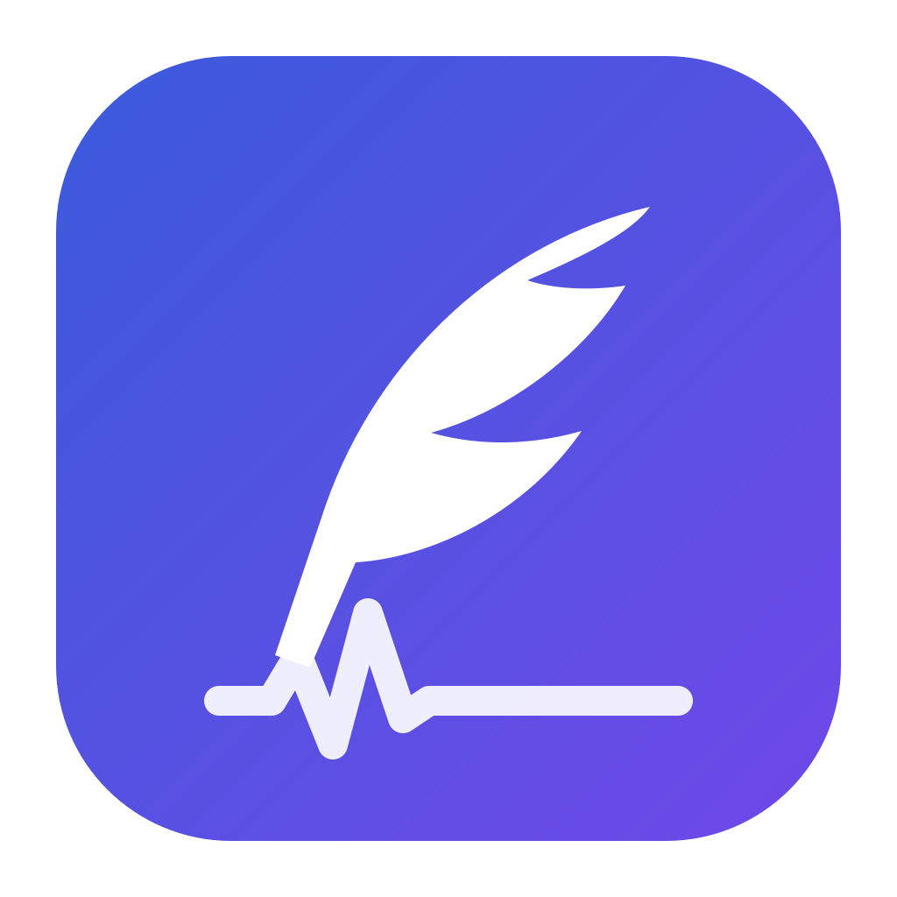
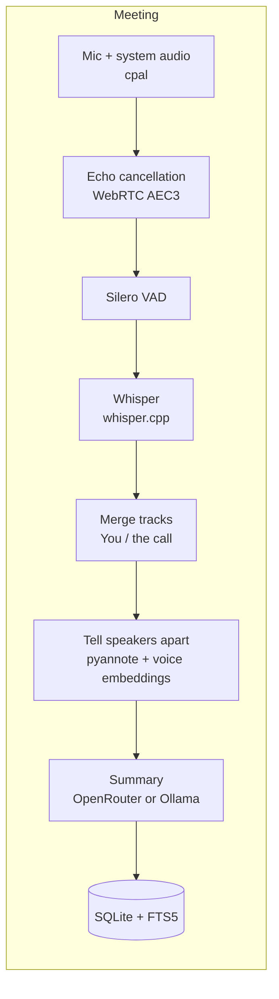
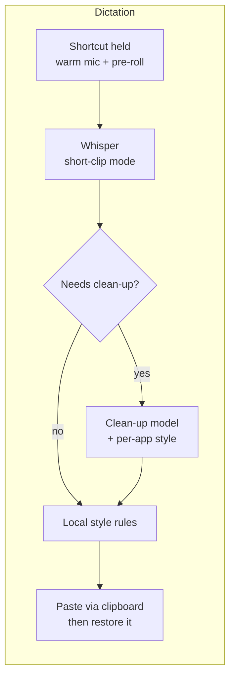

<div align="center">



# Quill

**Local-first meeting notes and dictation for macOS and Windows.**

Record any call and get a transcript plus structured notes. Or hold a key, speak, and have clean text typed into whatever app you're using. Audio is processed on your computer and never uploaded.

[](https://github.com/fisherinnovation/quill/actions/workflows/ci.yml)
[](#license)

</div>

## Contents

- [Features](#features)
- [Privacy](#privacy)
- [Platform support](#platform-support)
- [Installing](#installing)
- [Building from source](#building-from-source)
- [Using Quill](#using-quill)
- [Summary and clean-up models](#summary-and-clean-up-models)
- [Command-line tool](#command-line-tool)
- [Where your data lives](#where-your-data-lives)
- [How it works](#how-it-works)
- [Performance](#performance)
- [Development](#development)
- [Roadmap](#roadmap)
- [Known limitations](#known-limitations)
- [Contributing](#contributing) · [Security](#security) · [License](#license) · [Acknowledgments](#acknowledgments)

## Features

### Meeting notes

- **Works with any call app.** Zoom, Google Meet, Teams, a browser tab, a phone app mirrored to your computer. Nothing joins the call as a bot.
- **Two tracks, real speaker labels.** Your microphone is recorded as **You** and the call audio separately, so your words are never mixed up with anyone else's.
- **Tells the other people apart.** Voices on the call are separated into **Speaker 1**, **Speaker 2**… on your computer ([pyannote](https://github.com/pyannote/pyannote-audio) segmentation and voice fingerprints via [sherpa-onnx](https://github.com/k2-fsa/sherpa-onnx)). Rename them in the transcript (typing an existing name merges two), or say how many people were on the call to split them again instantly. The notes use the names.
- **Echo cancellation.** If you use speakers instead of headphones, a WebRTC echo canceller removes the call's audio from your microphone track before transcription.
- **Local transcription** with [Whisper](https://github.com/openai/whisper) through [whisper.cpp](https://github.com/ggerganov/whisper.cpp), GPU-accelerated: Metal on Apple Silicon, Vulkan on Windows (Nvidia, AMD and Intel graphics). Silence is skipped first, so Whisper doesn't invent text in quiet stretches.
- **Structured notes** written by a model you choose: TL;DR, decisions, action items with owners, discussion by topic and open questions. Long meetings are summarized in parts and combined.
- **A searchable library.** Full-text search across every transcript, click-to-rename titles, export to Markdown, all stored in a local SQLite database.
- **Compact storage.** Recordings are kept as 16 kHz FLAC once transcribed, about 70 MB per hour.

### Dictation

- **Hold a shortcut and speak** (<kbd>⌥ Option</kbd> + <kbd>Space</kbd> by default), and the text is typed wherever your cursor is. Or tap the shortcut to start and tap again to stop. <kbd>Esc</kbd> cancels.
- **Fast.** About 0.3 s from releasing the key to typed text on an M3 Pro, because Whisper stays loaded and runs in a mode tuned for short clips.
- **Clean-up only when it helps.** A model removes "um"s, applies self-corrections ("at 3, no wait, 4" becomes "at 4") and formats spoken lists. It only runs when there's something to fix, and its output is checked before use, so it can't type an answer to your question instead of your question.
- **Per-app style.** Casual in chat apps, formal in email, exact names and commands in code editors and terminals. Built-in defaults, and you can change any app.
- **Your words.** A vocabulary list for names and jargon, plus replacement rules ("open router" → "OpenRouter").
- **A floating indicator** with a live level meter, start and stop sounds, and a menu-bar status.
- **Your clipboard is preserved.** Text is inserted by pasting; whatever you had copied is put back, and the dictated text is hidden from clipboard managers.

### Insights (on Home)

- Words dictated, time saved compared with typing, speaking speed, streaks, a 30-day activity chart, time of day and top apps.
- Meeting count and hours, and your share of the talking.
- Built from counts only: Quill keeps numbers about dictations, not what you said.

## Privacy

Quill is built so that the sensitive parts stay on your computer.

| Data | Where it goes |
|---|---|
| **Audio** (meetings and dictation) | Never leaves your computer. Transcription runs locally. |
| **Meeting transcripts** | Sent to the summary model you choose: [OpenRouter](https://openrouter.ai) (routed only to providers that don't store or train on your data; zero-data-retention mode available), or a local [Ollama](https://ollama.com) model, so nothing leaves your machine. Summaries are optional. |
| **Dictated text** | Sent to the clean-up model only when clean-up runs (fillers, corrections, lists). Clean-up can be turned off or pointed at a local Ollama model. |
| **API keys** | Stored in the macOS Keychain or Windows Credential Manager, never in config files or logs. |
| **Logs** | Local files with events, timings and errors. Never transcripts, notes, dictated text or keys. |
| **Telemetry** | None. Quill makes no network requests other than the model calls above, downloading the speech models, and a daily check on GitHub for a new version (which can be turned off). |

For dictation, Quill reads the *name* of the frontmost app (for per-app style and insights), never its windows or contents.

## Platform support

| | macOS | Windows |
|---|---|---|
| Minimum OS | macOS 14.6 (system-audio capture uses Core Audio process taps) | Windows 10 / 11 |
| Transcription | Metal GPU on Apple Silicon | Vulkan GPU (Nvidia, AMD, Intel), or the CPU without one; CUDA in the CLI with a build flag |
| Meeting notes | ✅ | ✅ |
| Dictation | ✅ (<kbd>fn</kbd> key or a shortcut) | ✅ (a shortcut) |
| Installers | `.dmg`, Apple Silicon, not yet notarized | `.exe` / `.msi`, not yet signed |

Apple Silicon is strongly recommended on macOS: Whisper runs several times faster on its GPU. Linux isn't supported.

## Installing

Installers are attached to each [release](https://github.com/fisherinnovation/quill/releases), or you can [build from source](#building-from-source):

- **macOS:** `Quill_<version>_aarch64.dmg` (Apple Silicon). Open it and drag Quill to Applications.
- **Windows:** `Quill_<version>_x64-setup.exe` (installs for your user account; recommended), or the `.msi`.

The builds aren't signed by a registered developer yet, so the first launch needs one extra approval:

- **macOS:** opening Quill shows a message that Apple couldn't check it for malicious software. Click **Done**, then open **System Settings → Privacy & Security**, scroll to Security, and click **Open Anyway** next to the message about Quill. This is needed only once. Later versions keep your microphone, system-audio and Accessibility permissions.
- **Windows:** SmartScreen shows "Windows protected your PC". Click **More info**, then **Run anyway**.

Speech models download the first time they're needed (see [First run](#first-run)). The installers are built by [GitHub Actions](.github/workflows/release.yml) from the tagged source.

### Updates

Quill looks for a new version once a day. When there is one, Home, **Settings → Updates** and the About window offer **Restart to update**; nothing downloads or installs until you click it, and it waits if you're recording, dictating or a meeting is being written up. Updates are checked against Quill's signing key before they install, and your recordings, settings, models and permissions stay as they are. Turn the daily check off in **Settings → Updates** (where **Check now** still works). Version 0.1.0 predates the updater, so install the next version from the releases page once; later versions update themselves.

## Building from source

### Prerequisites

- **Rust**, latest stable, via [rustup](https://rustup.rs).
- **Node.js 24** and npm, for the app's interface.
- **CMake and a C/C++ compiler**, to build whisper.cpp:
  - macOS: `xcode-select --install` (the Command Line Tools are enough; full Xcode isn't needed) and `brew install cmake`.
  - Windows: [Visual Studio 2022 Build Tools](https://visualstudio.microsoft.com/visual-cpp-build-tools/) with the *Desktop development with C++* workload, which includes CMake.
- **Windows: the [Vulkan SDK](https://vulkan.lunarg.com/sdk/home#windows)**, for whisper.cpp's GPU backend. Install it yourself (it sets `VULKAN_SDK`), or from Git Bash run `export VULKAN_SDK="$(scripts/install-vulkan-sdk.sh)"`, which installs the version CI uses after checking its hash.

### Build and run

```sh
git clone https://github.com/fisherinnovation/quill.git
cd quill/app
npm ci

npm run app          # development: hot reload for the interface
npm run app:bundle   # macOS: build ~/Applications/Quill.app and open it
npx tauri build      # release bundle (.app/.dmg on macOS, .msi/.exe on Windows)
```

The first build compiles whisper.cpp and takes several minutes; later builds are incremental.

> [!TIP]
> **Developing on macOS:** use `npm run app:bundle` (not `app`) to test
> dictation, because macOS only lets real app bundles into the Accessibility
> list. It signs the build with a fixed identity, so microphone, system-audio
> and Accessibility permissions survive rebuilds. See [`app/README.md`](app/README.md).

### First run

1. A welcome screen explains what Quill records, then runs an **access check**: a few seconds of recording plus a short chime, which also brings up the permission prompts. Allow **Microphone** and **System Audio Recording**.
2. For dictation, open **Dictations** and click **Allow…** to grant **Accessibility**, which Quill needs to paste for you. Without it, dictated text is left on your clipboard.
3. The welcome screen also offers to download the models (about 1.7 GB): Whisper `turbo` (1.5 GB), the Silero VAD model (1 MB), and the speaker models (46 MB). They come from Hugging Face, and each is checked against its SHA-256 hash. If you skip that, they download the first time they're needed; pressing the dictation shortcut before then opens the Dictation page with the download's progress. **Settings → Models** lists each job that needs a model (speech recognition, silence detection, telling speakers apart, meeting notes and dictation clean-up), which model does it, and whether it's downloaded. Pick another Whisper size and it downloads straight away. Each local model can be re-downloaded (a fresh copy, checked against its hash again) or deleted; a deleted one downloads again when next needed. Downloads that no job uses are gathered at the end to delete in one go. Models live outside the app, so updates don't download them again.
4. Meeting notes and dictation clean-up use OpenRouter models by default, which need an API key. The welcome screen has a place to paste one, with a link to create it, or add it later in **Settings → OpenRouter**. To keep everything local, choose an Ollama model instead (see below).

## Using Quill

Quill opens on **Home**: buttons to record a meeting or set up dictation, your usage at a glance (words dictated, time saved, speaking speed, streak), your latest meetings, and below them the rest of your usage: the last 30 days, meetings and dictation in detail, and top apps. The sidebar leads to **Home**, **Meetings**, **Dictations** and **Settings**, and collapses to icons with the button at its foot or <kbd>⌘</kbd><kbd>\\</kbd> (<kbd>Ctrl</kbd>+<kbd>\\</kbd> on Windows); hover an icon for its name; **Meetings** lists every meeting by day and searches their transcripts, and **Dictations** lists what you've dictated. Settings has tabs: **General** (theme, OpenRouter, audio access, updates, logs), **Meetings**, **Dictation**, **Models** and **Storage**. The theme follows your computer's light or dark setting unless you pick **Light** or **Dark** under **Settings → General → Appearance**.

### Recording a meeting

Click **Record meeting** at the top of the sidebar, or use the menu-bar (tray) icon, when the call starts. Stop when it ends. Quill then:

1. Cleans speaker echo out of your microphone track.
2. Transcribes both tracks locally and merges them into one transcript, with your lines labelled **You**.
3. Tells the people on the call apart by voice (*Tell speakers apart* in Settings), as **Speaker 1**, **Speaker 2**…
4. Writes the notes, if *Summarize automatically* is on (Settings).
5. Compacts the audio to FLAC.

Progress shows in the meeting view and on the **Meetings** page. In the **Transcript** tab, click a speaker to name them. With 10 people on a call, Quill reliably separates everyone who talks for more than a minute or so, but people who say only a sentence or two may be merged into someone else; choosing the number of people under **People on the call** helps most. Telling speakers apart adds about 2 minutes per hour of audio, and the voice models (46 MB) download the first time. From a meeting you can re-summarize, copy the notes as Markdown, export them to a `.md` file, search its transcript, or delete it along with its audio.

The **Stats** tab shows how the conversation went: who talked and for how long, each person's pace, turns and questions, a timeline of who spoke when (click a stretch to read it in the transcript), moments like the longest monologue, the longest silence and the two people who went back and forth most, and the words and phrases that came up most. It's worked out on your computer from the transcript, and nothing extra is stored. Each dictation shows its own: words, pace against your usual, time saved compared with typing, and what clean-up took out. Word lists are English-first, so in other languages the most-used words can include common words.

If a recording turns out to have nothing said in it, it's marked **Nothing said** in the list of meetings, and opening it offers **Delete recording** or **Keep**. **Settings → Storage** lists how many such recordings there are and deletes them all at once, after you confirm. Quill never deletes them on its own.

Closing the window keeps Quill running in the menu bar, so a recording isn't cut off. Quit from the menu-bar icon.

**About Quill** (in the Quill menu on macOS, or the menu-bar icon's menu) shows the version and build, the models in use, links, and credits. **Copy diagnostic info** there copies what a bug report needs (no keys or text). On macOS, **Help → Report a Problem…** opens a new issue.

### Dictating

Put your cursor in any text field, then:

- **Hold** <kbd>⌥ Option</kbd> + <kbd>Space</kbd> while you speak and let go to type, or
- **Tap** it, speak, and tap again.

On macOS you can use <kbd>fn</kbd> (🌐) on its own instead: choose **fn** under **Settings → Dictation → Shortcut**. fn with another key (fn+Delete, fn+arrows, fn+F-keys) keeps working as usual. If macOS's own **Press 🌐 key to** setting isn't **Do Nothing**, pressing fn also opens the emoji picker or switches the input source; the Dictation page links to that setting. Using fn needs the same Accessibility permission as pasting.

Press <kbd>Esc</kbd> to cancel. A pill near the bottom of the screen shows the mic level while listening and "Typing…" while processing.

In **Settings → Dictation** you can change the shortcut, choose the language (your system language by default; auto-detection is available but about 0.5 s slower), turn clean-up on or off, set a style per app, and add vocabulary and replacements. The **Dictations** page shows whether dictation is ready and lists your dictations by day, newest first, with **Show more** for older ones. Open one to **Copy** it (in case text didn't land where you meant it to), correct it or delete it.

**Teaching Quill.** When Quill gets a name or term wrong, open that dictation from **Dictations**, click **Correct** and fix the text. Quill compares your fix with what it typed and suggests what to learn, under **Learn from your fixes** at the top of the **Dictations** page:

- A misspelled name or term ("Quil" → "Quill") becomes a vocabulary word, which steers both the speech model and the clean-up.
- Words typed apart ("open router" → "OpenRouter") become a replacement.

Nothing is learned until you click **Add**, and learned rules can be removed under **Settings → Dictation → Words**. Ordinary word changes ("their" → "there") aren't learned, because as a rule for every dictation they'd be wrong as often as right. With clean-up on, **About you** tells the clean-up model about you (your role, names you use, spelling preferences) so it gets them right. It's never added to your text.

**Testing accuracy.** **Settings → Dictation → Save dictations for testing** (off by default) keeps the audio of each dictation and what was typed, on your computer only, so you can measure how often Quill gets your words right with `quill-cli dictate`; see [`eval/dictation/README.md`](eval/dictation/README.md). It takes about 1 MB per minute of speech, and the same section shows how many are saved and deletes them.

### Per-app styles

| Style | Built in for | Effect |
|---|---|---|
| Casual | Slack, Messages, Discord, WhatsApp, Telegram, Teams, Signal | One-sentence messages lose their final period, the way people type in chat. Question marks stay. |
| Formal | Mail, Outlook, Spark, Superhuman, Word, Pages | Complete, properly punctuated sentences. |
| Technical | VS Code, Cursor, Zed, Xcode, JetBrains IDEs, Terminal, iTerm, Warp, Ghostty | Code names, file names, commands and flags kept exactly as spoken. |
| Default | Everything else | Your words, tidied up. |

The Casual period rule is applied locally, with no model call. The other styles shape the clean-up step when it runs. A style never makes clean-up run more often, so it adds no delay.

## Summary and clean-up models

Quill talks to models through [OpenRouter](https://openrouter.ai) (one API key, hundreds of models) or a local [Ollama](https://ollama.com) server.

| Use | Default | Why |
|---|---|---|
| Meeting notes | `anthropic/claude-haiku-5.5` | Accurate and cheap: a one-hour meeting costs well under a cent. |
| Dictation clean-up | `google/gemini-3.5-flash-lite` | The fastest consistent model in our comparison (0.66 s median); see [`eval/dictation/README.md`](eval/dictation/README.md). |

Choose them in **Settings → Models** (clean-up also in **Settings → Dictation**). Each picker offers:

- a few recommended models, with what each is good at and, for notes, the rough cost of an hour-long meeting from OpenRouter's current prices;
- the models installed in Ollama, to stay fully local;
- **Other OpenRouter model…**, which checks the id you type against OpenRouter's model list and shows its prices.

From the CLI, `-m` takes any OpenRouter id or `ollama:<model>`.

**OpenRouter key:** in **Settings → OpenRouter**, click **Add key…** (or **Change key…**) and paste it, or from a terminal run `quill-cli keys set openrouter`. **Get a key** opens openrouter.ai/keys. The key is stored in the macOS Keychain or Windows Credential Manager. On Windows, Settings shows whether a key is stored. On macOS, opening Settings never reads the keychain, because that alone can ask for your password, so it can't tell until the key is used. Quill reads the key only when it writes notes or tidies dictation, once per launch. For development, the `QUILL_OPENROUTER_API_KEY` environment variable overrides the keychain.

**Data handling:** requests always ask OpenRouter to route only to providers that don't collect your data. *Zero data retention only* (Settings → OpenRouter) is stricter and supported by fewer models.

## Command-line tool

`quill-cli` exposes the same engine for scripting, testing and evaluation:

```sh
cargo run --release -p quill-cli -- --help
```

| Command | What it does |
|---|---|
| `record` | Record the microphone and system audio into a new library meeting (or `--out <dir>`). |
| `transcribe <file or dir>` | Transcribe a WAV/FLAC file or a recording folder (echo cancellation and VAD on by default; `--diarize [--speakers N]` tells the people on the call apart). |
| `diarize <file or dir>` | Who spoke when, optionally scored against a reference RTTM (see [`eval/diarization`](eval/diarization)). |
| `summarize <dir or transcript.json>` | Write meeting notes (`-m` picks the model, e.g. `-m ollama:qwen3:8b`). |
| `dictate <clips…>` | Run the dictation pipeline on audio files and show each step's output and timing; `--polish-models a,b` compares clean-up models. Clips with a reference (`clip.txt`, what should have been typed) are scored by word error rate. |
| `models list` / `models download <name>` | Manage models: Whisper (`tiny`, `base`, `small`, `medium`, `turbo-q5`, `turbo`, `large-v3`), VAD and the diarization models. |
| `bench <file>` | Compare transcription speed across models (`--short-clip` for dictation settings). |
| `eval` | Compare summary models on cost, latency and quality judged by an LLM. |
| `import <dir>` | Add a recording folder made elsewhere to the library. |
| `compact [dirs…]` | Convert recordings' WAVs to FLAC (the app does this automatically). |
| `keys set\|delete openrouter` | Manage the API key in the OS keychain. |

The CLI and the app share one library, so meetings recorded or imported in either appear in both.

## Where your data lives

**Settings → Storage** shows how much space Quill takes in total, split into meeting audio, models, notes and transcripts, logs, and the app itself.

| | macOS | Windows |
|---|---|---|
| Data folder | `~/Library/Application Support/com.fisherinnovation.Quill` | `%APPDATA%\fisherinnovation\Quill\data` |

Inside it:

- `quill.sqlite`: meetings, transcripts, summaries, dictation history and insight counts.
- `recordings/<meeting id>/`: audio (`mic`/`system`, `.wav` while recording and `.flac` afterwards), `transcript.json` (the two-track transcript), `speakers.json` (voice fingerprints of the people on the call, used to re-split speakers; deleted with the meeting), `summary.md`, `recording.json`. The recordings folder can be moved in **Settings → Storage**.
- `models/`: downloaded Whisper, VAD and speaker models.
- `settings.toml`: settings (safe to edit while Quill isn't running).
- `logs/`: daily log files, kept for two weeks.
- `dictation-samples/`: only with **Save dictations for testing** on. Each dictation's audio (`.flac`), what was typed (`.typed.txt`) and the app it went into (`.json`).

Deleting a meeting in the app removes its database rows and its audio folder. Dictation history can be turned off or cleared, and insight counts can be reset separately (**Reset** at the bottom of Home). Saved dictation samples are deleted from **Settings → Dictation → Testing accuracy**.

## How it works





The Rust workspace is split so that the app and the CLI are thin layers over library crates:

| Crate | Responsibility |
|---|---|
| [`quill-audio`](crates/quill-audio) | Microphone and system-audio capture (cpal: Core Audio process taps on macOS, WASAPI loopback on Windows), live mic for dictation, resampling, echo cancellation, WAV/FLAC, sounds. |
| [`quill-stt`](crates/quill-stt) | Speech-to-text behind a `Transcriber` trait: whisper.cpp via whisper-rs, Silero VAD, model catalog and verified downloads. |
| [`quill-llm`](crates/quill-llm) | LLM providers behind an `LlmProvider` trait (OpenRouter, Ollama), keychain access, versioned prompt templates. |
| [`quill-diarize`](crates/quill-diarize) | Telling speakers apart: sherpa-onnx segmentation and voice embeddings, Quill's own clustering, DER scoring. |
| [`quill-core`](crates/quill-core) | Meeting pipeline, track merging, speaker labelling, summaries, the dictation pipeline, the SQLite library, settings, insights. |
| [`quill-insert`](crates/quill-insert) | Typing text into the focused app (clipboard + simulated paste), identifying that app, and watching the fn key on macOS. |
| [`quill-eval`](crates/quill-eval) | The evaluation harness for summary models. |
| [`quill-cli`](crates/quill-cli) | The `quill-cli` command-line tool. |
| [`app/`](app) | The desktop app: [Tauri v2](https://tauri.app) in Rust ([`app/src-tauri`](app/src-tauri)) with a React + TypeScript interface ([`app/src`](app/src)). |

Prompts live as versioned Markdown in [`prompts/`](prompts) and are compiled into the binary. Every summary records which prompt version and model produced it. Design decisions and the reasoning behind them are recorded in [`docs/DESIGN_NOTES.md`](docs/DESIGN_NOTES.md).

## Performance

Measured on a MacBook Pro (M3 Pro, 36 GB):

| | Result |
|---|---|
| Meeting transcription (`turbo`, Metal) | about 24× real time: a one-hour meeting takes roughly 2½ minutes |
| Dictation, release to typed text | about 0.3 s, or about 0.95 s when clean-up runs |
| Meeting audio on disk | about 70 MB per hour once transcribed (about 2 GB per hour while recording) |
| Word error rate on the synthetic benchmark meeting | 2.6% (`turbo`) |

Details and methods: [`eval/benchmarks.md`](eval/benchmarks.md) (transcription) and [`eval/dictation/README.md`](eval/dictation/README.md) (dictation). The benchmark audio is synthetic speech, so real-call error rates will be higher.

## Development

```sh
cargo fmt --all --check
cargo clippy --workspace --all-targets --locked -- -D warnings
cargo test --workspace --locked
(cd app && npm run build)          # type-checks and builds the interface
```

CI runs exactly these on macOS and Windows for every push and pull request.

**Releases:** bump `version` in `app/src-tauri/tauri.conf.json` (and `app/package.json`), commit, and push a matching tag (`git tag v0.2.0 && git push origin v0.2.0`). The [release workflow](.github/workflows/release.yml) builds the macOS `.dmg` and the Windows installers and attaches them to a draft GitHub Release to review and publish. Running the workflow by hand (Actions → Release → Run workflow) builds the same installers as downloadable artifacts, without a release. Locally, `cd app && npx tauri build --bundles app && sh scripts/package-macos.sh` makes the `.dmg` in `dist-release/`.

- **Tests that need models** are ignored by default. Run them with `QUILL_TEST_MODEL=<path to ggml model> QUILL_TEST_VAD_MODEL=<path to VAD model> cargo test -p quill-stt -- --ignored`.
- **Previewing the interface without Rust:** `cd app && npm run dev`, then open http://localhost:1420. In a plain browser the app uses sample data ([`app/src/dev/mock.ts`](app/src/dev/mock.ts)). URL flags show particular states: `?onboarding`, `?recording`, `?listening`, `?processing`, `?failed`, `?nopaste`, `?empty`, `?light`, `?indicator`, `?about` (the About window), `?others` (call audio as one "Others" speaker), `?nomodels` (nothing downloaded), `?noollama` (Ollama not running), `?nokey` (no OpenRouter key), `?fn` (fn as the dictation shortcut), `?dark` (the dark theme).
- **Evaluating summary models:** see [`eval/README.md`](eval/README.md). Put your own meeting transcripts in `eval/transcripts/private/`, which is gitignored.
- **Changing a prompt:** copy it to the next version directory (for example `prompts/summary-v3/`) rather than editing a shipped one, so results stay comparable.
- **The website** lives in [`site/`](site): static HTML, CSS and a little JavaScript, with no third-party requests. `node site/build.mjs` builds it into `site/_site`, filling in the version, the latest release's downloads and the source links. CI builds it on every run and publishes it to GitHub Pages from `main`. The header video is recorded from the app's browser preview by `node site/video/render.mjs` (see [`.claude/skills/site-video`](.claude/skills/site-video/SKILL.md) for how it's planned).

The codebase enforces a few rules through lints: no `unsafe` outside small, documented platform wrappers; no `unwrap`/`expect` outside tests; typed errors in libraries. [CONTRIBUTING.md](CONTRIBUTING.md) has the details.

## Roadmap

Planned:

- Signed and notarized builds
- Data retention settings, such as deleting audio after a set time while keeping transcripts
- Remembering voices across meetings, so regular colleagues are named automatically

Ideas being considered: live captions during meetings, asking questions across past meetings, detecting when a meeting starts, merging your own typed notes into the summary, and taking speaker names from the call app (opt-in).

## Known limitations

- **Builds aren't code-signed or notarized yet,** so the first launch needs one extra approval (see [Installing](#installing)). Updates after that install without it.
- **Windows** has had less real-world use than macOS. Its GPU transcription (Vulkan) is new and so far measured on few machines. On a PC with both integrated and dedicated graphics, whisper.cpp uses the first GPU Vulkan lists, which may not be the faster one.
- **People who barely speak** on a large call may be merged into someone else, and two similar voices are sometimes treated as one. Fix either in the transcript. Voices aren't remembered between meetings yet.
- **Several people in one room on one microphone** are all "You".
- **Language:** Whisper supports about 100 languages, but the summary prompts and the dictation tests are English-first.
- **The floating indicator** may not appear over full-screen apps on macOS.
- **The default dictation shortcut** (<kbd>⌥ Space</kbd>) is also the default for some launchers and assistants. If another app already uses it, Quill says so and you can choose another.
- Transparent windows use a Tauri option built on private macOS interfaces. That's fine for distribution outside the Mac App Store, but would block an App Store release.

## Contributing

Contributions are welcome: bug reports, testing on Windows, prompt and model evaluations, and code. Please read [CONTRIBUTING.md](CONTRIBUTING.md) before opening a pull request, and open an issue first for anything large.

## Security

Please don't report security issues in public issues. See [SECURITY.md](SECURITY.md) for how to report them privately, and for a summary of how Quill handles keys and data.

## License

Licensed under either of

- Apache License, Version 2.0 ([LICENSE-APACHE](LICENSE-APACHE) or <http://www.apache.org/licenses/LICENSE-2.0>)
- MIT license ([LICENSE-MIT](LICENSE-MIT) or <http://opensource.org/licenses/MIT>)

at your option.

Unless you explicitly state otherwise, any contribution intentionally submitted for inclusion in the work by you, as defined in the Apache-2.0 license, shall be dual licensed as above, without any additional terms or conditions.

Speech models downloaded at runtime have their own licenses: [Whisper](https://github.com/openai/whisper) (MIT), [Silero VAD](https://github.com/snakers4/silero-vad) (MIT), [pyannote segmentation-3.0](https://huggingface.co/pyannote/segmentation-3.0) (MIT) and NVIDIA NeMo [TitaNet-small](https://catalog.ngc.nvidia.com/orgs/nvidia/teams/nemo/models/titanet_small) (CC BY 4.0), the last two as exported to ONNX by sherpa-onnx.

## Acknowledgments

Quill stands on excellent open-source work, including:

- [whisper.cpp](https://github.com/ggerganov/whisper.cpp) and [whisper-rs](https://codeberg.org/tazz4843/whisper-rs), with OpenAI's [Whisper](https://github.com/openai/whisper) models
- [Silero VAD](https://github.com/snakers4/silero-vad) for voice activity detection
- [sherpa-onnx](https://github.com/k2-fsa/sherpa-onnx), [pyannote](https://github.com/pyannote/pyannote-audio) and NVIDIA [NeMo](https://github.com/NVIDIA/NeMo) for telling speakers apart, and the [AMI Meeting Corpus](https://groups.inf.ed.ac.uk/ami/corpus/) for testing it
- [Tauri](https://tauri.app) for the desktop shell
- [cpal](https://github.com/RustAudio/cpal) for audio capture, and [rubato](https://github.com/HEnquist/rubato) for resampling
- [sonora](https://github.com/dignifiedquire/sonora), a Rust port of WebRTC's audio processing, for echo cancellation
- [flacenc](https://github.com/yotarok/flacenc-rs) and [claxon](https://github.com/ruuda/claxon) for FLAC
- [enigo](https://github.com/enigo-rs/enigo) and [arboard](https://github.com/1Password/arboard) for typing and the clipboard
- [OpenRouter](https://openrouter.ai) and [Ollama](https://ollama.com) for model access

Projects that informed Quill's design: [Meetily](https://github.com/Zackriya-Solutions/meeting-minutes), [Handy](https://github.com/cjpais/Handy), [OpenWhispr](https://github.com/HeroTools/open-whispr) and [VoiceInk](https://github.com/Beingpax/VoiceInk).
